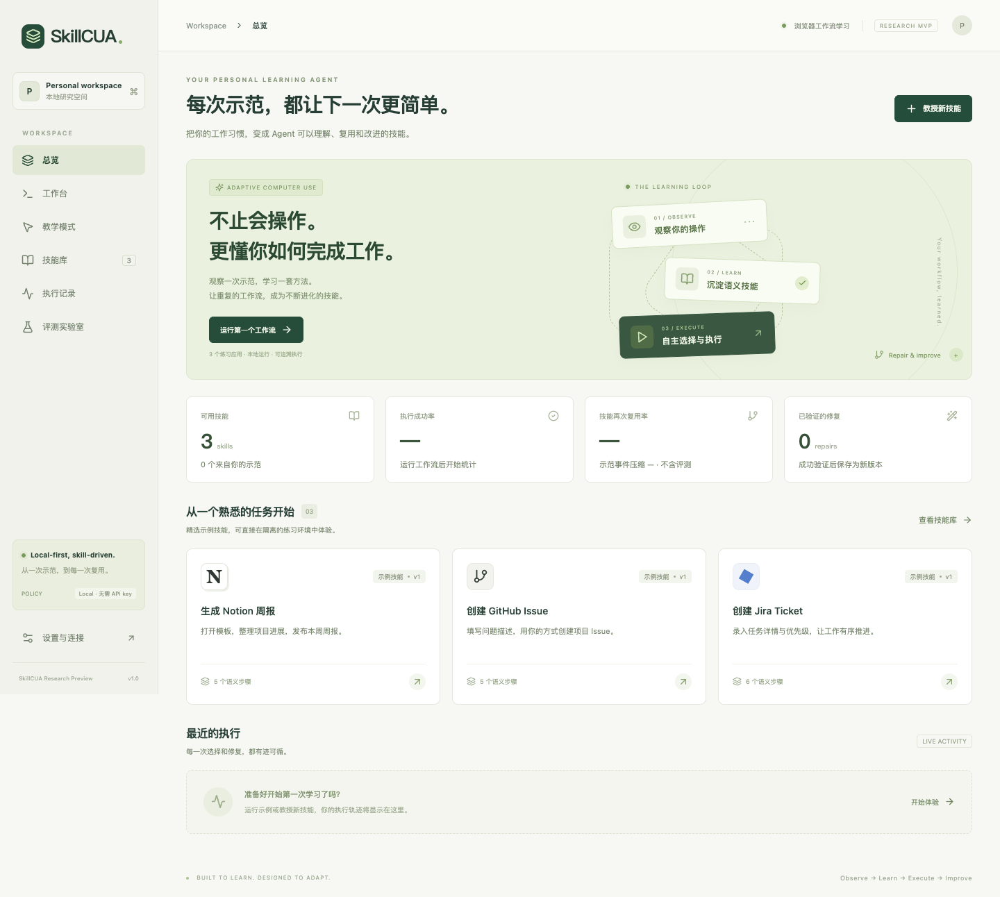

# SkillCUA

**Adaptive Computer Use Agent with Skill Learning**

观察用户示范，学习语义工作流，检索并复用技能，在页面变化时修复，并通过实际执行轨迹评测效果。

这是一个可运行的研究型 Browser Workflow Learning MVP。它包含完整前后端、Playwright 运行时、SQLite 记忆、Jev 决策适配器和自动化测试。没有 API key 也可以完成整个本地闭环；界面会明确显示当前使用的策略。



## 启动

需要 **Node.js 22.13+** 和 Google Chrome。推荐 Node.js 22 LTS。

```bash
npm ci
npm run dev
```

打开 **http://127.0.0.1:3210**。请使用该完整地址，不使用 `localhost`，服务会检查 Host 和 Origin。

未安装 Chrome 时：

```bash
npm run browser:install
cp .env.example .env
# 将 .env 中 BROWSER_CHANNEL 改为 chromium
npm run dev
```

生产构建：

```bash
npm run build
npm start
```

不依赖远程字体、第三方数据库或云服务即可体验默认模式。`data/` 下的数据会跨重启保留。

## 五分钟演示

1. 进入「工作台」，输入“帮我生成 Notion 周报”，点击「检索技能」。审阅并修改标题和正文，确认执行。执行记录会显示真实 Playwright 步骤和最终截图。
2. 将页面变体切换为「按钮更名」，再执行。`Submit` 变为 `Publish` 后，Agent 会重新观察，选择唯一的同角色语义候选，完成验证，再将工作流保存为新版本。再次执行同一变体不再需要修复。
3. 进入「教学模式」，选择 Notion，开始教学。在嵌入的练习页面中打开模板、填写、提交，再点击「完成示范并提取技能」。真实 DOM 事件被转换为新的参数化 Skill。
4. 在技能库查看原始事件压缩后的工作流、参数及 JSON，修改输入并复用新技能。
5. 切换「歧义按钮」，先确保使用含 `Submit` 的原始工作流。当 `Publish` 和 `Send` 同时出现时，Agent 会停止，不会猜测，也不会写入修复版本。
6. 进入「评测实验室」，运行完整评测，比较两种策略并打开每一条实际轨迹。

GitHub Issue、Jira Ticket、Notion 周报各有一个本地练习应用。它们是**受控仿真页面**，并非真实 SaaS 集成；本地演示不会创建外部 Issue、工单或报告。初始 3 个 Skill 明确标记为精选示例，不计作用户示范。

## 核心能力

| 模块     | 实现                                                                    |
| -------- | ----------------------------------------------------------------------- |
| 感知     | DOM 角色、可访问名称、可见性、禁用状态；执行使用 Playwright `getByRole` |
| 教学     | 嵌入式本地录制 + Playwright 独立浏览器录制；点击、输入、选择、勾选      |
| 学习     | 合并连续输入，抽取填写参数，生成语义步骤、来源条件和完成条件            |
| 记忆     | SQLite 持久化 Skill、版本、示范、执行、评测及成功使用的应用偏好         |
| 检索     | 中英文概念归一化 + 384 维特征哈希向量 + cosine/词覆盖率 + 有界偏好加分  |
| 决策     | 本地可解释策略，或真实 Jev typed Choice API；候选之外的动作被拒绝       |
| 执行     | 独立浏览器上下文、精确 origin 限制、串行任务队列、停止执行、结果验证    |
| 修复     | 同角色高分候选、歧义检查、重新定位；验证成功才提交版本                  |
| 可观察性 | 每步前后页面结构、策略来源、决策、耗时、失败原因、修复及结束截图        |
| 评测     | 三任务 × 四条件 × 两策略；24 次浏览器执行，支持 JSON 导出               |

无匹配技能时请求新的示范。当前任务规划通过检索和用户确认参数完成，不包含自由生成工作流的 LLM Planner，也不会自行探索未知网站。报告内容来自用户填写的参数，不会伪装成模型生成。

## Jev 连接

```bash
cp .env.example .env
# 在 .env 中填写 TYPESAFE_API_KEY
# 可选 JEV_MODEL=jev-latest
npm run dev
```

适配器使用 TypeSafe 官方 `POST https://api.typesafe.ai/v1/systemone`，发送 `state`、`model`、`questions.decision.type="choice"` 和有限的 `criteria`，读取 `answers.decision.choice/confidence`。参见 [TypeSafe Quick start](https://docs.typesafe.ai/introduction/quickstart) 与 [Choice 文档](https://docs.typesafe.ai/primitives/choice)。

Jev 负责技能候选选择、已定位动作的执行判断和受约束修复选择；不生成内容、选择器或任意代码。超时为 10 秒，置信度低于 0.70、非候选答案或服务错误均停止决策。不会在 Jev 出错时无标记地切回本地策略。用户可以在界面中显式选择技能后运行。

**本地模式的 score 是启发式匹配分数，不是模型概率。** 当前随项目附带的评测使用本地策略。Jev 请求格式、低置信度、超时和异常回答使用模拟响应测试；未提供 API key 时，不声称已验证真实在线 Jev 推理质量。

启用 Jev 会向该 API 发送任务描述、技能名称/描述、操作名称和候选标签。不会发送参数字段值或截图。数据中若含敏感内容，请使用本地策略或先进行清理。

## 真实网页与登录态

在 `.env` 中填写精确来源，例如：

```dotenv
ALLOWED_ORIGINS=https://github.com
BROWSER_STORAGE_STATE=./data/auth.json
```

需要登录的网站，先通过独立的登录流程创建本地会话：

```bash
npm run auth -- https://github.com/login
```

在打开的浏览器中自行登录，回到目标网站后，在终端按 Enter 保存。此命令不启用录制。登录态文件包含有效的会话凭据，以 `0600` 权限创建；`data/` 已被 `.gitignore` 排除。

重启服务，进入「教学模式 → 真实浏览器」，输入同一来源内的任务页面。完成示范后指定真实成功文本，并提取工作流。执行会创建独立上下文，只从显式配置的文件载入目标来源对应的 cookie 和 localStorage。不会连接用户的日常 Chrome profile 或自动读取其他应用凭据。

真实网页运行必须在界面审阅输入并确认，HTTP API 则需要 `approved: true`。已录制的所有步骤均会执行，包括提交。真实 GitHub / Jira / Notion 账号未在本项目的本地测试中登录或写入；其当前 SaaS 页面兼容性不作保证。

目前支持同一来源、单主页面、具有稳定可访问名称的常规控件。弹窗会关闭；跨源导航、跨源框架、Shadow DOM 录制、canvas、拖拽、文件上传、组合富文本操作、MFA 自动化和任意桌面应用不在该 MVP 支持范围。登录态过期时重新运行 `npm run auth`。

## 验证与评测

```bash
npm run build       # TypeScript 检查 + 前端生产构建
npm test            # 纯逻辑、持久化和 Jev 协议测试
npm run test:e2e    # Chrome 真浏览器端到端测试，自动启动隔离的 3211 服务
```

保持主服务运行后：

```bash
npm run evaluate
```

将结果写入 `reports/evaluation-latest.json`。界面中的「评测实验室」调用相同的评测引擎。评测不会修改用户 Skill 或个人偏好，不会调用 Jev。自动化测试的数据写入 `data/e2e/`，与个人工作空间分开。

本项目已运行的本地实验：固定语义回放在 9 个可执行条件中完成 6 个，自适应策略完成 9 个；三个更名条件均修复成功，三个歧义条件均正确停止。样本小且环境受控，不能外推到真实网站，也不代表和通用 LLM Agent 的比较。指标定义与实验矩阵见 [研究与评测说明](docs/RESEARCH.md)。

交付检查已通过：23 项单元测试、10 项 Chrome 端到端测试、TypeScript 检查、生产构建、格式检查，以及 `npm start` 的实际浏览器启动检查。评测界面截图见 [实测结果](docs/screenshots/evaluation.png)。

## 目录

```text
shared/types.ts       领域类型、输入校验与练习任务定义
server/
  browser.ts          Playwright 生命周期、感知、录制、登录态
  learning.ts         示范到参数化语义工作流
  semantic.ts         特征向量、检索、候选修复匹配
  policy.ts           Local / Jev typed decision
  engine.ts           执行、停止、验证、修复、评测
  store.ts            SQLite 记忆与版本事务
  app.ts              HTTP API、来源检查与教学会话
  labs.ts             三个有页面变体的本地练习应用
  seed.ts             明确标注的三个示例技能
src/                  React 工作台、教学、技能库、轨迹和评测界面
public/recorder.js    共享 DOM 感知与事件录制
scripts/              可重复评测和显式登录态创建
tests/                单元测试和真实浏览器集成测试
reports/              实际评测结果
docs/                 研究设计、HTTP API 与实现约束
```

HTTP 接口见 [API 文档](docs/API.md)。环境变量见 [.env.example](.env.example)。

## 数据与运行约束

- 服务仅监听 `127.0.0.1`，拒绝非预期 Host 和外域 Origin，没有开放 CORS。
- SQLite 开启 WAL，Skill 修复、统计及执行结果在事务中提交。版本历史保留旧工作流，恢复时创建新版本。
- 重启后，未完成执行被标记为失败，录制被取消，不自动重放可能已经产生副作用的动作。
- 只在目标尚未定位时尝试修复，点击超时或结果验证失败后不重试提交动作。
- 录制忽略密码、隐藏输入和识别出的密钥/验证码字段，但这不是通用 DLP。其余示范值、执行参数、轨迹和截图保存在本机 `data/`。
- 截图目前只保存执行结束或失败时的页面；逐步观察使用结构化页面元素。
- 全部 HTML、CSS、应用代码为本项目实现，没有复制参考项目代码。架构参考 [Voyager](https://voyager.minedojo.org/)、[Playwright 语义定位](https://playwright.dev/docs/locators)、[Hermes Jev Skills](https://github.com/kerpopule/hermes-jev-skills)。

## 常见问题

- **浏览器无法启动**：安装 Chrome，或 `npm run browser:install` 后设置 `BROWSER_CHANNEL=chromium`。Linux CI 使用 `npx playwright install --with-deps chromium`。
- **403**：访问 `http://127.0.0.1:3210`；不要从其他来源嵌入或反向代理该开发服务。
- **目标未获授权**：在 `ALLOWED_ORIGINS` 中添加目标的精确协议、域名及端口，重启服务。路径不属于 origin。
- **匹配不明确**：明确应用名称、选择一个技能，或录制新的示范。本地词表不是通用语义模型。
- **“完成标志在执行前已经存在”**：选择能证明本次任务完成的独特完整文本。
- **修复没有保存**：修复只有在整个工作流的完成条件通过后写入版本；失败轨迹仍保留候选与错误。
- **SQLite experimental warning**：Node 22/23 的内置 SQLite 会显示该提示，不影响运行。数据库无需另行安装。

MIT License.
