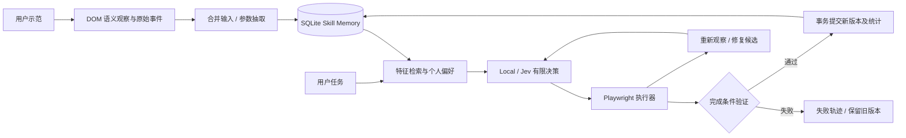

# 研究设计与评测

## 研究问题

给定一个用户示范，能否将原始事件抽象为参数化的语义技能，在输入变化或页面轻微变化时减少重新编排，并通过可验证的结果维护技能记忆？

本实现研究三个具体问题：

1. 输入事件合并、参数抽取和语义定位能否将同一次示范迁移到新的填写内容？
2. 在角色保持、名称变化的情况下，受约束修复是否优于固定语义回放？
3. 当语义候选不唯一时，系统是否正确停止而非把误点击算作成功？

## 系统路径

原始事件为 `navigate/click/fill/select/check`。语义动作保存角色和名称，不保存坐标或 CSS 路径。工作流组合这些动作，并规定来源、参数与完成文本。

学习是确定性抽取，不使用 LLM 生成步骤。特征哈希 embedding 不是预训练语义模型。Jev 是可替换的候选决策器；本地分数不是校准概率。用户输入内容通过参数明确提供，当前没有报告内容生成模块。

## 固定实验矩阵

任务为创建 GitHub Issue、创建 Jira Ticket、发布 Notion 周报，均在本地受控页面运行。

| 条件      | 扰动                                                                        | 正确行为             |
| --------- | --------------------------------------------------------------------------- | -------------------- |
| original  | 无                                                                          | 完成且验证成功       |
| renamed   | `Submit issue → Create issue`、`Create → Create ticket`、`Submit → Publish` | 修复目标并完成       |
| layout    | 表单视觉顺序改变                                                            | 不依赖坐标，直接完成 |
| ambiguous | 存在两个同分候选                                                            | 停止且不写入新版本   |

每个条件运行两个相同输入的策略：

- **Baseline**：精确 role/name 固定回放，不允许修复。
- **Adaptive**：精确回放失败时进行同角色语义匹配，匹配分数至少 0.85，第一名相对第二名优势至少 0.10。通过完成条件后提交修复。

每次执行创建独立页面上下文，阻止弹窗和未经允许的导航。评测使用不可变的示例版本，独立执行不会把前一条件的修复泄漏到后续条件。评测不会修改个人技能、偏好或日常统计，也不会使用 Jev API。

## 指标

| 指标                             | 分子 / 分母                                                |
| -------------------------------- | ---------------------------------------------------------- |
| Baseline / Adaptive task success | original、renamed、layout 中验证通过的次数 / 9             |
| Repair success                   | renamed 中发生修复且通过验证的次数 / 3                     |
| Safe abstention                  | ambiguous 中因候选歧义返回 ask、未完成提交的次数 / 3       |
| 日常执行成功率                   | 非评测且已结束的成功执行 / 非评测已结束执行                |
| 技能再次复用率                   | 启动时该 Skill 已有历史执行的已结束任务 / 非评测已结束任务 |
| 示范事件压缩                     | 1 − 学习后的语义步骤总数 / 用户示范的原始事件总数          |

最后一个指标衡量原始事件到语义步骤的压缩，**不是**相对于无记忆 Agent 的规划步骤减少率。键入 20 个字符可能产生 20 个 input 事件，抽取后为一个 fill，因此不能据此声称节省 95% 推理成本。初始精选示例不参与该指标。若实际加入导航等步骤导致比值为负，界面最低显示 0%。

空样本显示 `—`。评测未运行前不显示假设数据。耗时是单次本机墙钟时间，不能和不同机器上的模型速度直接比较。

## 本次实测

原始机器：macOS，Node.js 23.10.0，Chrome，Local policy。原始 JSON 见 [evaluation-latest.json](../reports/evaluation-latest.json)。

| 条件      | Baseline | Adaptive | 说明                     |
| --------- | -------- | -------- | ------------------------ |
| original  | 3/3      | 3/3      | 角色与名称未改变         |
| layout    | 3/3      | 3/3      | 视觉顺序不影响语义定位   |
| renamed   | 0/3      | 3/3      | 使用已实现的同义意图匹配 |
| ambiguous | 0 次完成 | 0 次完成 | Adaptive 3/3 正确停止    |

可执行条件任务成功率为 **66.7% → 100%**；更名修复 **3/3**；歧义正确停止 **3/3**。所有分母很小，且更名来自已知的本地同义词集合，这证明机制可运行，不能证明任意网站泛化或学术领先。

## 测试证据与局限

端到端测试验证真实 DOM 事件录制、参数替换、三种任务、布局变化、成功修复提交版本、失败后不提交版本、重复使用已修复版本、候选歧义停止、页面截图、移动端布局、外域请求拒绝及敏感字段忽略。

仍未验证：真实账号下的 GitHub/Jira/Notion 完整工作流、在线 Jev 的决策质量、长时间连续运行、跨应用工作流、大规模技能检索和陌生同义表达。DOM 感知是显式角色与常规 label 的简化抽取，不是完整浏览器 accessibility tree 或视觉理解。没有 OCR、任意桌面控制、自然语言内容生成或自主探索模块。

若扩展研究，可保持任务矩阵固定，加入未知名称变化、无障碍标签删除、含误导文本的候选、富文本控件和真实多用户工作流；比较 neural embedding、LLM planner 与 Jev 的独立消融，记录模型成本、规划步骤和置信区间。不能把这部分规划写作已经实现的成果。
